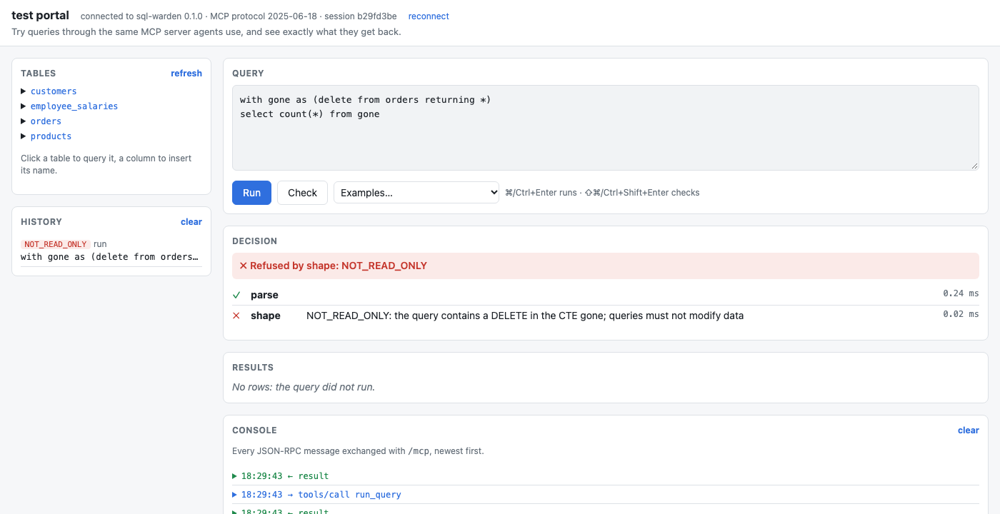

# sql-warden

A governed SQL gateway that lets an AI agent query a real database safely. The rules are
enforced by the server, not trusted to the prompt.

An agent sends SQL over [MCP](https://modelcontextprotocol.io). sql-warden checks it, runs
it only if every check passes, and records the request in a separate audit database either
way. The warehouse can be Postgres or Snowflake.

<picture>
  <source media="(prefers-color-scheme: dark)" srcset="docs/images/portal-refused-dark.png">
  
</picture>

## How it works

Every query goes through the same checks, in order, and the first one that fails refuses it:

| Check       | What it enforces                                                                  |
|-------------|-----------------------------------------------------------------------------------|
| **parse**   | the SQL parses, and isn't built to tie the parser up                              |
| **shape**   | one read-only `SELECT`: no writes, no stacked statements, no dangerous functions  |
| **access**  | only the tables and columns the caller's profile allows                           |
| **masking** | sensitive columns come back masked, and can't be filtered or computed on          |
| **cost**    | the database's own planner prices the query, and too expensive a one never runs   |
| **budget**  | each session and caller has a budget of queries, cost, rows and refusals          |

A few decisions shape the rest of the code:

- **What runs is what was checked.** The SQL is parsed once, every check reads that tree, and
  the query sent to the database is written out again from it. The text the agent sent never
  reaches the database.
- **Refusals are answers.** Each has a code and a reason (`COLUMN_NOT_ALLOWED`,
  `COST_TOO_HIGH`, ...), so an agent can see what was wrong and fix its query.
- **Nothing is answered without an audit record.** If the audit database can't be written
  to, queries are refused.
- **The database holds the same line.** Queries run as a read-only role, in a read-only
  transaction, with a statement timeout and a row cap. A server won't start as a role that
  can write, so one wrong check isn't enough to change data.

## Quick start

You need [uv](https://docs.astral.sh/uv/) and Docker.

```bash
uv sync                                          # Python 3.12 and the dev tools, in .venv
docker compose -f dev/docker-compose.yml up -d   # a demo warehouse (:5433) and audit database (:5434)
cp warden.example.yaml warden.yaml               # a policy with three profiles: public, support, admin
```

`check` is a dry run that shows what each check decides. `query` runs the SQL if they all
pass:

```text
$ uv run sql-warden check "select id, name from products"
✓ parse   1.8 ms
✓ shape   0.1 ms
✓ access  33.9 ms
✓ cost    6.3 ms
✓ budget  0.0 ms
→ allowed (profile public; dry run, nothing was executed)
  cost: 1.02 of 10,000 allowed (most of it: Seq Scan on products)
  note: added LIMIT 51 (row cap 50 + 1 to detect truncation)
  session budget: 0 of 25 queries, 0 of 50,000 cost, 0 of 500 rows, 0 of 10 refusals used
  would run: SELECT id, name FROM public.products LIMIT 51
```

Some more to try:

```bash
uv run sql-warden query "select id, name, price_cents from products order by id"
uv run sql-warden check "select email from customers"                    # refused: TABLE_NOT_ALLOWED
uv run sql-warden check "delete from products"                           # refused: NOT_A_SELECT
uv run sql-warden query "select phone, ssn from customers" --profile support   # rows, with both masked
uv run sql-warden audit tail                                             # everything asked so far
```

There is also a browser page for trying queries by hand, shown above. It is a real MCP
client, so it shows exactly what an agent gets back:

```bash
uv run python -m tests.portal        # opens http://127.0.0.1:8765/
```

## Connecting an agent

`sql-warden serve` is the MCP server. It offers five tools: `run_query`, `check_query`,
`list_tables`, `describe_table` and `budget_status`.

```bash
uv run sql-warden serve                      # stdio: the agent starts it
uv run sql-warden serve --transport http     # Streamable HTTP at http://127.0.0.1:8000/mcp
```

For Claude Code, from the repo root:

```bash
claude mcp add sql-warden -- uv run --quiet --directory "$PWD" sql-warden serve
```

Then ask it about the demo data, or ask it for something it shouldn't have (salaries, a raw
SSN, a cross join over a million rows) and watch the refusal come back.

Over HTTP with an `auth` section in the policy, one server serves every profile: each
caller's token (an API key or an OIDC JWT) decides which profile their queries are checked
against. [docs/deploy.md](docs/deploy.md) covers running that as a service: the container
image, database roles, secrets, Kubernetes and ECS.

## The policy

Everything sql-warden enforces comes from one file, `warden.yaml`. A profile says what one
kind of caller may read:

```yaml
profiles:
  support:
    tables:
      public.customers: "*"
      public.orders: [id, customer_id, quantity]
    masks:
      public.customers.ssn: redact      # [REDACTED]
      public.customers.phone: partial   # ********0001
    budgets:
      max_queries: 100
```

[warden.example.yaml](warden.example.yaml) documents every key, and
`sql-warden config validate` checks a file (add `--live` to check it against the real
database roles too).

## Working on it

```bash
uv run ruff check . && uv run ruff format --check .
uv run mypy                                # strict
uv run pytest                              # everything; integration tests need Docker
uv run pytest -m "not integration"         # the unit tests alone
```

Integration tests start their own throwaway Postgres containers, so they don't need the demo
stack and never touch it. The Snowflake engine has two more suites, run on their own; see
[Snowflake](docs/snowflake.md).

### The docs

The pages in [docs/](docs/index.md) read fine on GitHub, and also build into a site with
search and navigation. To read it locally:

```bash
uvx --with mkdocs-material mkdocs serve            # http://127.0.0.1:8001/, rebuilt as you edit
uvx --with mkdocs-material mkdocs build --strict   # or build it once into site/, failing on a broken link
```

`uvx` fetches MkDocs for that run only, so nothing is added to the project's dependencies.
The site's layout is in [mkdocs.yml](mkdocs.yml).

### Where things are

```
src/sql_warden/
  warden.py        the facade: parse, check, regenerate the SQL, run it, record it
  pipeline/        one module per check, and the runner that stops at the first refusal
  engines/         Postgres and Snowflake, behind one protocol
  audit/           the audit log's schema, writer and reader; budgets are kept there too
  server.py        the MCP tools, over stdio and HTTP
  auth.py          API keys and OIDC tokens
  config.py        the policy file's model
  cli.py           the sql-warden command
tests/
  unit/            no database needed
  integration/     against Postgres in Testcontainers
  fakesnow/        the Snowflake engine on an emulator
  snowflake/       the same against a real account, skipped unless one is configured
  portal/          the browser test page
dev/               the demo stack, its seed data, and a load test
deploy/, docs/     deployment SQL and the guides
mkdocs.yml         the docs site's layout
```

## Status

On Postgres, everything above works and is tested, up to running as a service behind
tokens. The Snowflake engine is tested on an emulator, on saved query plans and by live
tests against a real account, but **a server has not yet run on one**.
[docs/plan.md](docs/plan.md) has the roadmap and what was built at each step.

## More

The documentation starts at [docs/index.md](docs/index.md):

- [Getting started](docs/getting-started.md): the walkthrough above, in full
- [How it works](docs/how-it-works.md): a request's path, the design decisions, and a map of
  the code
- [The checks](docs/checks.md): what each check refuses, and every refusal code
- [Deploying](docs/deploy.md): running it as a service
- [The policy file](docs/policy.md): every section and key, and profiles
- [Command reference](docs/cli.md): every command and option
- masking, budgets, the audit log, the MCP server, operating a server and Snowflake each
  have a page too, listed on the [docs home](docs/index.md)

MIT licensed.
